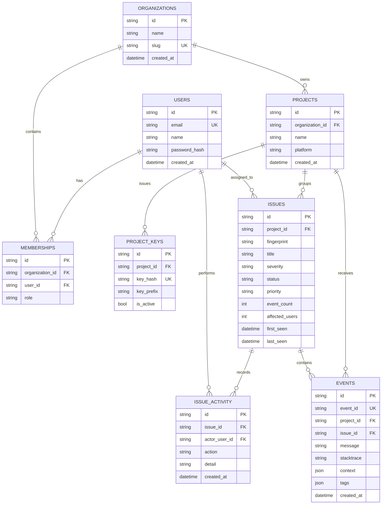

# Database ERD

Key constraints: unique normalized user email; unique organization slug; unique `(organization_id, user_id)` membership; unique hashed project key; unique `(project_id, fingerprint)` issue; unique event ID. Fingerprints are scoped to project. Event tags and context are JSON/JSONB-compatible SQLAlchemy JSON columns.
